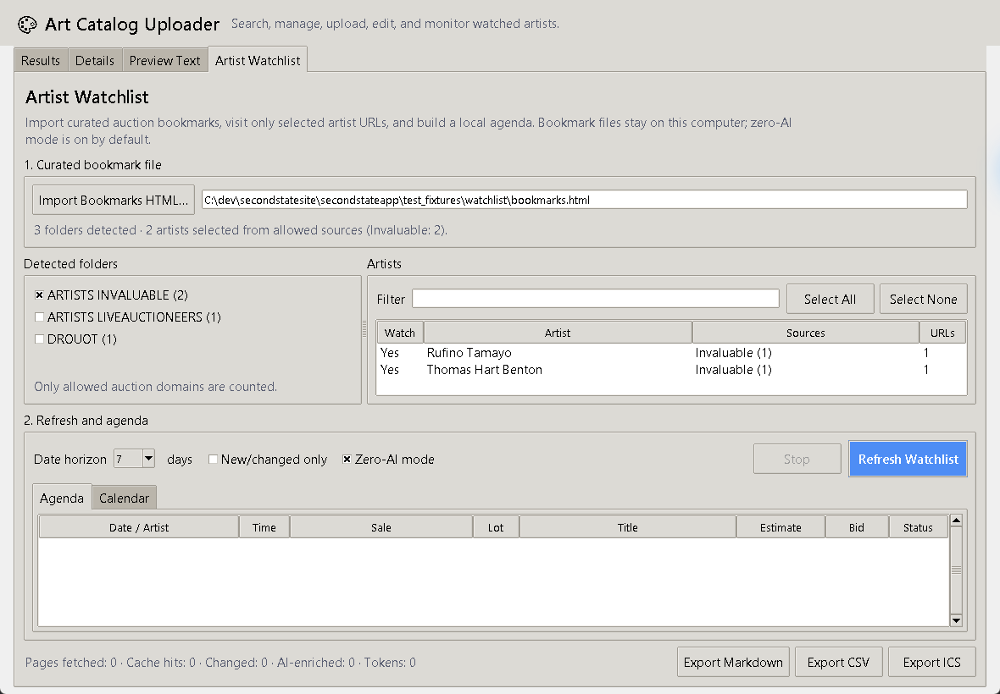
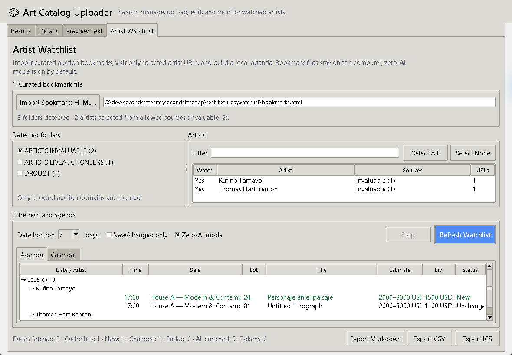

# Artist Watchlist

Issue #33 replaces broad Auction Search with a local, bookmark-driven agenda. The desktop app visits selected public auction URLs from an exported browser bookmark file. Invaluable artist searches and Heritage sale catalogs are supported; LiveAuctioneers and Drouot remain visible at import time but report that their adapters are not available yet.

## Heritage sales

1. Import your updated `ARTIST-LINKZ.html` with **Import Bookmarks HTML…**. The file stays on your computer.
2. Enable the **HERITAGE** folder. **ARTISTS INVALUABLE** remains the default selection and can stay enabled.
3. Select the sale in **Artists / sales**. A bookmark such as **10-22 SALE** with `auction_name=8280` watches all lots returned by that catalog, including any non-print objects in the sale. The bookmark title identifies the sale selection; each lot keeps its own artist name.
4. Choose a date horizon that includes the sale. For the October 22, 2026 sale viewed on October 10, use **14** or **30 days**; the default 7 days excludes it.
5. Click **Refresh Watchlist**. Results use the existing agenda, exports, cache, and automatic website-calendar sync.

Heritage may reject direct requests with HTTP 403 even when a browser is logged in. The desktop app does not inherit your open browser session. If retrieval is blocked, save the sale's results pages using **Webpage, Complete** in that browser, select one Heritage sale in the watchlist, and click **Import Saved Heritage Pages…**. Keep the saved HTML and its matching companion folder together: for example, `10-22-HS.html` beside `10-22-HS_files`. Select all saved results pages for that sale together. This reads the saved HTML locally, retains other current agenda lots, and runs the same website-calendar sync. No login cookies or saved HTML are uploaded.

For the 151-lot catalog, switch to **List** view and choose **200** results per page before saving to capture it in one file, or save each results page in Gallery view. Wait until the lot cards and their images have loaded. A saved gallery page with 72 cards contains only those 72 lots; the importer reports partial coverage so the remaining pages can be added. Both layouts are supported. Gallery cards without their own date use the selected sale heading's single-day date. Dates without session times remain all-day / time unverified; the importer does not invent a closing time. Starting bids are displayed as **No bids**, separately from actual current bids.

Saved artwork thumbnails are matched to each Heritage lot number and read only from that HTML file's companion folder. They are converted to JPEG with metadata removed, at most 1600 pixels per side and 512 KiB each, before the normalized image pixels are cached and synced. Local file paths are never sent as auction URLs. Public lazy-image URLs remain a fallback where the saved HTML preserves them. Missing, unreadable, or placeholder thumbnails produce an import notice; save the complete page again to supply the missing images. The website must run the matching calendar-image update before it can accept these saved thumbnails. Re-import the saved page and sync again after updating both the desktop app and website.

### Save larger Heritage images

The optional [`heritage_prepare_images.js`](../scripts/heritage_prepare_images.js) helper prepares larger primary images before saving a catalog. Run it in your browser's DevTools console on the live Heritage sale results page, such as the page whose URL contains `auction_name=8280`. It works on the lot cards currently loaded in that page.

1. Choose **List** and **200** results per page, or prepare and save each results page separately. Wait for the catalog to load.
2. Open DevTools with **F12**, select **Console**, and run the complete contents of `scripts/heritage_prepare_images.js`.
3. Wait for the on-page banner to finish. It reports **X/Y images ready**, failures, and any larger originals retained. The helper requests Heritage's own product images at up to **612 × 600**, with four loads at a time, and checks decoded pixel dimensions. Sources may provide smaller originals; a request succeeds only if it actually increases the available pixels without reducing either dimension.
4. Once ready, press **Ctrl+S** and select **Webpage, Complete**. Keep the resulting HTML and its matching `_files` folder together. In Artist Watchlist, select the Heritage sale and use **Import Saved Heritage Pages…**, then check the website-sync result.
5. Use **Restore originals** when you are done. During loading, **Stop and restore originals** cancels preparation and restores the original image attributes. Save the prepared page before restoring.

The helper updates the existing catalog images so the browser can include them in the saved page. A separate image wall or preview in a shadow DOM is not a reliable substitute for **Webpage, Complete**. Failed images retain their original source; restore and rerun to retry them. The helper leaves larger images in place and does not change bids, bid forms, or navigation. It does not read cookies, browser storage, or account details; it uses ordinary image loads from recognized Heritage CDN URLs, without `fetch`, canvas extraction, or CORS workarounds. If an image request is refused, it reports that image as failed.

Saved pages are snapshots: their bids and availability reflect when you saved them. Pages from a different sale are rejected. A partial set of pages never marks missing lots ended. Retained cached lots can therefore show older bids and availability than the newly imported page; a successful calendar sync does not make those observations current. Save and import updated pages when you need newer bids, and use **Sync Website Calendar** if a sync needs to be retried.

If the local import succeeds but website sync is not configured, the app now explains the missing settings and leaves **Sync Website Calendar** clickable. Put the website's existing `CATALOG_API_KEY` in the ignored project-root `.env` (alongside `SECONDSTATE_BASE_URL=https://secondstate.art` if needed). A sync retry reloads newly added settings without another import. Live source-access warnings, such as Heritage HTTP 403, are separate from website-sync configuration.

## Screenshots

Bookmark import, safe folder selection, artist preview, and zero-AI default:



Synthetic agenda with efficiency metrics and export controls:



## Architecture

```text
local bookmark HTML
  -> selected folders + explicit domain allowlist
  -> Invaluable public catalog JSON / Heritage catalog HTML adapters
  -> normalized lot records
  -> local SQLite content-hash cache and diff
  -> optional compact ambiguous-record enrichment
  -> date/artist agenda + Markdown/CSV/ICS exports
  -> private website calendar sync
```

The implementation is split by responsibility:

- `catalogapp/bookmark_watchlist.py`: Netscape bookmark parsing, nested URL decoding, folder/domain filtering, artist/sale labels, and URL deduplication.
- `catalogapp/watchlist_adapters.py`: adapter interface plus deterministic Invaluable catalog-result, card, embedded JSON, detail, and pagination parsing. Invaluable's `/search` page is a JavaScript shell, so live refreshes use the same public `/catResults` JSON request as the page itself. Compatible selected artists are combined into an OR-facet request and split back into their individual bookmark memberships locally.
- `catalogapp/watchlist_fetch.py`: conservative HTTP retries/rate limiting and an explicit opt-in Playwright profile fallback.
- `catalogapp/watchlist_models.py`: stable normalized lot schema and local duplicate markers.
- `catalogapp/watchlist_cache.py`: SQLite lot, membership, source-run, and AI-enrichment caches.
- `catalogapp/watchlist_service.py`: incremental refresh, detail-fetch decisions, ended-item detection, horizons, and efficiency metrics.
- `catalogapp/watchlist_saved_pages.py`: local saved Heritage results import, sale validation, and cache updates without treating partial snapshots as complete catalogs.
- `catalogapp/watchlist_images.py`: lot-to-thumbnail matching, companion-folder confinement, and bounded JPEG normalization without source image metadata.
- `catalogapp/watchlist_enrichment.py`: optional strict structured-output batching for ambiguous compact records.
- `catalogapp/watchlist_exports.py`: agenda Markdown, CSV, and RFC 5545 ICS generation.
- `catalogapp/watchlist_sync.py`: authenticated upload of normalized results to the staff-only website calendar.
- `catalogapp/watchlist_ui.py`: bookmark/folder/artist/sale selection, refresh/stop controls, saved Heritage page import, agenda/calendar views, and exports.

## Local data and privacy

- The bookmark file is read locally and is never copied into the repository or website database.
- The complete bookmark HTML and full scraped pages are never sent to OpenAI.
- Only entries in a user-selected folder and the explicit `invaluable.com`, `liveauctioneers.com`, `drouot.com`, or `ha.com` allowlist are imported. Private Google Drive and unrelated URLs are rejected.
- Normal HTTP retrieval is the default. Invaluable catalog requests do not use browser cookies, a member token, or a logged-in profile. Optional Playwright use requires both `WATCHLIST_USE_PLAYWRIGHT=1` and a user-selected `WATCHLIST_PLAYWRIGHT_PROFILE` directory.
- The fetchers do not enter credentials, solve CAPTCHAs, bypass paywalls, or work around HTTP 401/403/429 controls.
- Local settings and cache data live under `%LOCALAPPDATA%\SecondState\ArtistWatchlist`, outside the repository.
- Zero-AI mode is enabled in the UI by default. Optional enrichment also requires `OPENAI_WATCHLIST_ENRICHMENT_ENABLED=1`.
- Enrichment sends only allowlisted normalized fields. URLs, bookmark data, page HTML, cookies, and credentials are excluded.
- Website calendar sync sends normalized sale/lot fields, the source's public primary-image URL when available, and sanitized artwork thumbnails imported from a saved catalog. Original image metadata, local paths, bookmark files, page HTML, cookies, cache internals, and browser credentials are excluded from the uploaded records. The configured catalog API key is used only to authenticate the sync request.
- The Responses API request has no tools and uses a strict JSON schema. Ambiguous records are batched and cached by deterministic content hash.

Optional local environment settings:

```dotenv
OPENAI_WATCHLIST_ENRICHMENT_ENABLED=0
OPENAI_WATCHLIST_MODEL=gpt-5-mini
OPENAI_WATCHLIST_MAX_RECORDS_PER_BATCH=50
WATCHLIST_USE_PLAYWRIGHT=0
WATCHLIST_PLAYWRIGHT_PROFILE=
```

## Incremental behavior and metrics

Each lot is keyed by source plus source lot ID, falling back to its canonical URL. The cache stores a search-card hash and a normalized visible-content hash. An unchanged complete card is served from cache without fetching its detail page. New, changed, or still-incomplete cards may retrieve details. Successfully refreshed bookmark memberships that disappear are marked ended.

If a source is temporarily unavailable, the refresh keeps the last known active lots for that bookmark in the agenda and reports that cached data is being shown. It never marks lots ended from an incomplete or failed source refresh.

Every refresh reports:

- pages fetched;
- cache hits;
- new, changed, and ended lots;
- AI-enriched records;
- input, output, and total token usage.

Invaluable's `currentBid` and `bidCount` values are normalized separately so the desktop agenda can distinguish a live current bid from **No bids** and an unavailable bid field from **N/A**. Bid-count changes participate in the content hash and therefore appear as changed lots on refresh.

## Calendar behavior

ICS output defaults to one event per auction sale. Matched artists and lots are grouped in the description. A timezone-aware source time is converted to UTC. A source date without a time becomes an all-day event and the description marks the time as unverified. Event-per-lot and reminders are supported by the export function but are intentionally not the noisy UI default.

The private web calendar at `/calendar/` is populated automatically after a successful refresh and can be retried with **Sync Website Calendar**. A selected date with lots exposes **Browse all N lots**, which opens a single modal viewer with the current lot's primary image, details, counter, progress, wraparound previous/next controls, and keyboard navigation. Website staff can explicitly select lots with saved Artprice links for the shared Email Tray; sync never selects, deselects, or sends them. See [`auction-calendar.md`](auction-calendar.md) for authentication, deployment, and Gmail setup.

## Migration note

Historical migration `0012_auctionsearchjob.py` is retained because it may already be applied. New migration `0013_delete_auctionsearchjob.py` safely removes that deployed model. The runtime model, imports, routes, views, polling helpers, environment constants, and broad-search tests are deleted.

## Manual verification

1. Run `python manage.py migrate` and confirm migration `0013_delete_auctionsearchjob` applies.
2. Start the catalog desktop app and confirm the notebook shows **Artist Watchlist**, with no **Auction Search** tab.
3. Export a small synthetic or test browser bookmark HTML file. Do not add a real bookmark export to Git.
4. Click **Import Bookmarks HTML…** and confirm `ARTISTS INVALUABLE` is selected by default.
5. Confirm private/unrelated domains do not appear and source/artist/sale counts are shown before refresh. Enable a synthetic **HERITAGE** folder and confirm its sale title appears separately from artist names.
6. Select a small artist subset, keep **Zero-AI mode** enabled, choose a horizon, and click **Refresh Watchlist**.
7. Confirm status reports pages, cache hits, changes, AI records, and tokens; use **Stop** during a refresh once.
8. Refresh the same fixture again and confirm unchanged complete lots produce cache hits and no repeated detail or AI request.
9. Inspect Agenda and Calendar views, then export Markdown, CSV, and ICS. Import the ICS into a temporary calendar and confirm one event per sale.
10. Verify upload, website listing edit/delete/reorder, gallery rendering, and artwork description generation still work.

## Automated verification

```powershell
.\.venv\Scripts\python.exe manage.py test
.\.venv\Scripts\python.exe -m compileall -q catalogapp secondstateapp
```

The synthetic tests cover bookmark safety, repeated decoding, adapters, pagination, retries, caching/diffs, duplicate marking, timezone/all-day ICS behavior, zero-AI mode, strict compact batching, enrichment caching, legacy removal, and preserved website regressions. No test contacts an auction site or OpenAI.

## Invaluable troubleshooting

A successful `GET /search` is not proof that auction data was returned: Invaluable currently responds with HTTP 200 and an empty JavaScript application shell. The live adapter therefore posts only the bookmarks' public artist/category/search filters to `/catResults`, combines compatible artist facets to reduce request volume, validates the JSON schema, and reports a source error if the endpoint returns HTML or an unexpected response. This prevents an empty shell from being recorded as a successful zero-result refresh. A temporary 401/403/429 is not bypassed; the agenda retains last-known cached lots and the user can retry later.
